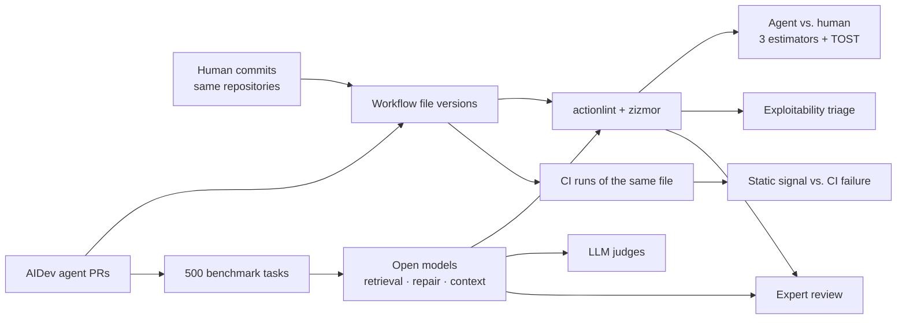

<div align="center">

# Agent-Authored CI Workflows

**Are AI coding agents writing the CI/CD pipelines that run with your repository's secrets as well as people do?**

[](https://doi.org/10.5281/zenodo.23765185)
[](LICENSE)
[](LICENSE-DATA.md)


</div>

Coding agents such as Claude Code, GitHub Copilot, OpenAI Codex, Cursor, Devin and Google Jules now open pull
requests that add and change GitHub Actions workflows. A workflow is unusual code: it runs with a repository token
and secrets, can be triggered by outsiders, and pulls third-party actions at run time. This repository contains the
data, code and labels of an empirical study of those workflows, from mining and static analysis to a controlled
generation benchmark and expert review.

## At a glance

| | |
|---|---|
| 🤖 **Agent workflows** | 21,508 workflows added by 6 agents in 3,876 repositories (AIDev), first drafts and merged versions |
| 👩‍💻 **Human baseline** | 1,407 workflows added by developers to the same repositories in the same period, plus a 2019–2022 baseline |
| 🔍 **Static analysis** | actionlint 1.7.12 and zizmor 1.31.1 on every file version; ~2.9 M findings, mapped to breaking, high-severity security and unpinned-reference outcomes |
| 🛡️ **Exploitability** | Deterministic triage of high-severity findings: outsider-reachable trigger × attacker-controlled data × privileges |
| ⚙️ **CI runs** | Static findings linked to the CI runs of the same file at the same commit; taxonomy of 600 failed runs |
| 🧪 **Benchmark** | 500 tasks reconstructed from real agent pull requests; 4 open models × 6 conditions (zero-shot, retrieval, validator repair, repository context) |
| ⚖️ **Judges** | Blind LLM judges on findings and on pairwise task fulfilment, both presentation orders |
| 🧑‍🔧 **Expert labels** | Two practitioners (senior DevOps engineer, platform engineer), 220 independent labels in two rounds |

## How the pieces fit



## Repository layout

```
scripts/                 collection, linting, statistics, benchmark, judges, rater tools, tables, figures
data/processed/          workflow versions, human baseline, linted files, all analyser findings (parquet)
data/annotation/         120-finding sample, LLM judge labels, rater materials and anonymised labels (R1, R2)
data/bench/              500 tasks, action catalogue, every generation and repair round, pairwise judgements
results/                 every CSV and log produced by the analysis scripts
logs/                    GPU power logs (energy per task)
tools/schemastore/       SchemaStore workflow schema (held-out validity check)
```

## Quick start

```bash
git clone https://github.com/m-peker/agent-authored-ci-workflows.git
cd agent-authored-ci-workflows
pip install -r requirements.txt

python scripts/make_tables.py    # LaTeX tables -> results/tables/
python scripts/make_figures.py   # PDF figures  -> results/figures/
```

Both run on a laptop in minutes from the included results. All commands are run from the repository root; the seed
is 42 throughout.

## Reproducing each part

| Part | Scripts | Needs |
|---|---|---|
| Agent vs. human statistics (E1 GEE, E2 repository fixed effects, E3 matching, TOST, MDE) | `run_v3_local.sh` → `robustness.py`, `power.py`, `estimand_check.py`, `contamination.py`; `scope_sensitivity.py`, `exploitability.py`, `exploit_compare.py`, `pinning_split.py` | included data, CPU |
| Static findings vs. CI outcomes | `link_runs.py`, `ci_failure_taxonomy.py`, `transitions.py` | CI run data (re-collected) |
| Benchmark analysis | `bench_analyze.py`, `bench_ablate_k.py`, `bench_independent.py`, `bench_pairwise_summary.py`, `bench_pairwise_bias.py` | included generations, CPU |
| Expert labels | `human_validation_analyze.py`, `human_precision_correct.py`, `human_validation_ctx_analyze.py` | included labels, CPU |
| Full re-collection | `extract_workflow_prs.py` → `fetch_files.py` → `clean_and_rework.py` → `run_linters.py`; `fetch_human_baseline.py`; `fetch_runs.py`; `wf_meta.py` | GitHub API token in `.gh_token`, hours |
| Re-running the benchmark | `setup_llm_env.sh`, `bench_run_model.sh <name> <hf_repo> all`, `judge_run_model.sh`, `pairwise_run_model*.sh` | one 48 GB GPU, vLLM 0.11.0 |

Generation uses greedy decoding; outputs can still differ slightly across GPUs and library versions.

## What is not in this repository

* **AIDev** (public, CC BY 4.0): download from [huggingface.co/datasets/hao-li/AIDev](https://huggingface.co/datasets/hao-li/AIDev)
  into `data/raw/aidev/`.
* **Workflow files of third-party repositories.** Every file is identified by repository, commit and path in
  `data/processed/`; `fetch_files.py` and `fetch_human_baseline.py` download them again. Only the files shown to
  the raters are included, inside the rater materials.
* **Repository snapshots and raw GitHub API responses**: re-created by `bench_fetch_context.py`, `fetch_runs.py` and
  `ci_failure_taxonomy.py`.

## Licence

Code under the [MIT licence](LICENSE); data produced here under [CC BY 4.0](LICENSE-DATA.md). Material derived from
AIDev keeps AIDev's licence, and files from third-party repositories keep the licence of their repository.

## Citation

If you use this data or code, please cite the archived version:

```bibtex
@misc{peker2026agentci,
  author    = {Peker, Musa},
  title     = {Agent-Authored CI Workflows: Data and Code},
  year      = {2026},
  publisher = {Zenodo},
  doi       = {10.5281/zenodo.23765185}
}
```

## Contact

Musa Peker · Ozveri R&D Center, Bursa, Türkiye · musa.peker@ozdilek.com.tr
